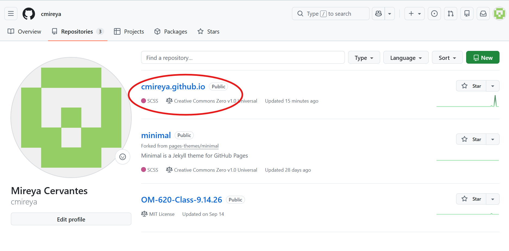
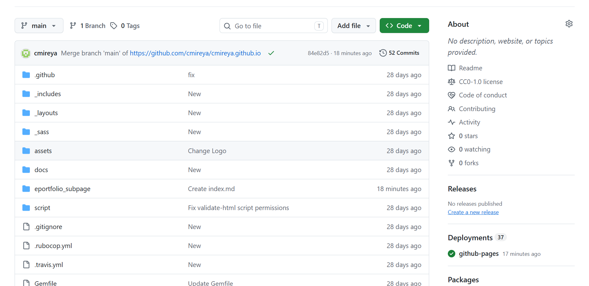
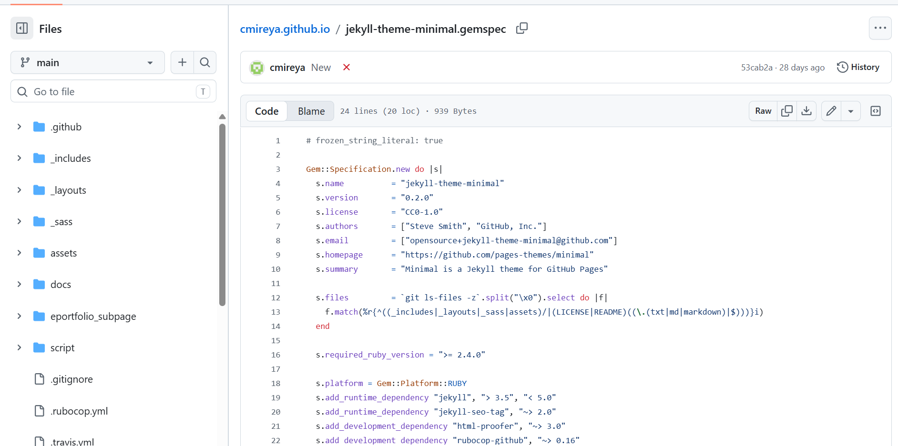
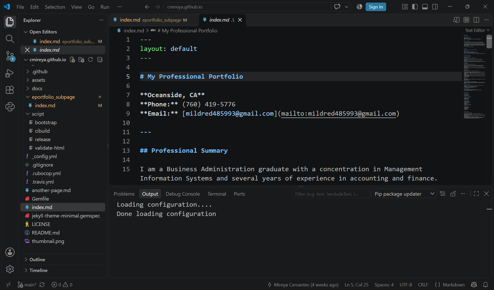
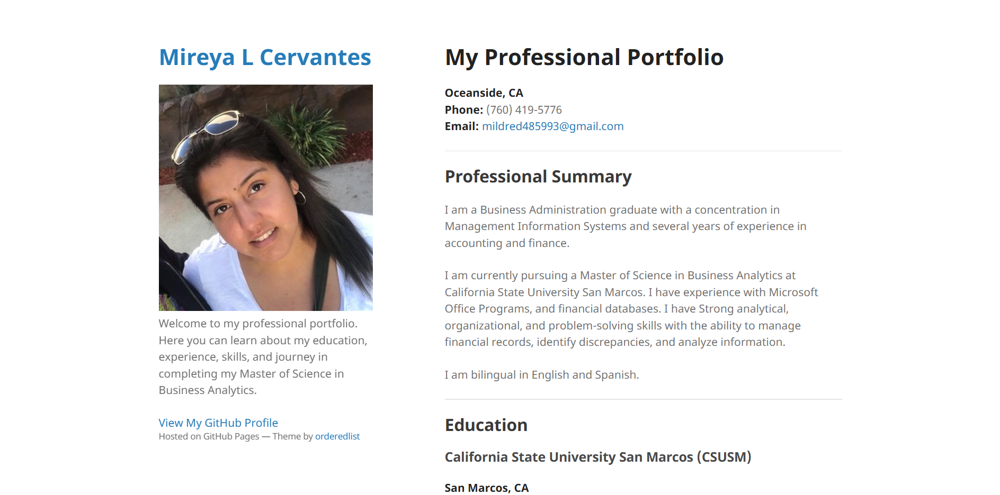

# How I Created My GitHub E-Portfolio

## Introduction

For Milestone I project, I created my professional e-portfolio
using GitHub Pages (online and desktop version), Jekyll, Visual Studio, and Markdown.

The purpose of my professional e-portfolio is to show my
educational background, professional experience,
technical skills, and academic progress.

In this page I will explain the steps I followed in order to create
my e-portfolio.

## Step 1: Creating My GitHub Repository

I started by creating a GitHub repository named
`cmireya.github.io`.

This repository stores the files that are needed to publish
my e-portfolio through GitHub Pages.

## Step 2: Setting Up GitHub Pages

After creating my repository, I configured GitHub
Pages to publish my website.

GitHub Pages allows users to host websites directly
from their GitHub repositories.

## Step 3: Using the Minimal Theme

I used the Jekyll Minimal theme to create a simple
and professional layout for my portfolio.

I customized the theme to display my personal,
educational, and professional information.

[Minimal Theme](https://github.com/pages-themes/minimal)

## Step 4: Editing My Portfolio

I used Visual Studio Code to edit my Markdown files.

The main file, `index.md`, contains the information
displayed on my homepage.

I organized my portfolio into sections including:

- My Professional Summary
- Education
- Professional Experience
- Technical Skills
- Current Projects

## Step 5: Publishing My Website

After completing my changes, I committed and pushed
my files to GitHub.

I reviewed my published website to make sure
everything displayed correctly.

## Step 6: Troubleshooting

During the development process, I encountered
GitHub Actions errors related to file permissions
and Jekyll dependencies.

I reviewed the error messages and updated my
workflow configuration to resolve the issues.

This experience helped me understand the importance
of troubleshooting and testing website changes.

## Final E-Portfolio

Below is a screenshot of my completed e-portfolio.

[Visit My E-Portfolio](https://cmireya.github.io/)

## Conclusion

Creating my e-portfolio helped me develop technical
skills using GitHub, Markdown, Visual Studio Code,
and Jekyll.

I plan to continue updating my portfolio with
academic projects throughout my master's program.